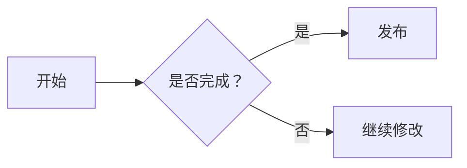

# Inkdown

Inkdown 是真正的 Windows 本地 Markdown 实时编辑器。它直接读写磁盘文件，不需要浏览器、PWA、
HTTP 服务或云端账号。

> 本项目仅参考 Typora 公开可见的“内容优先、低干扰写作”理念；未下载、访问、复制、逆向或使用
> Typora 的私有源码、品牌和视觉资产。

## 桌面能力

- Windows 原生菜单及新建、打开、保存、另存为、退出快捷键
- 原生文件对话框和直接覆盖保存；支持 `.md`、`.markdown`、`.txt`
- 当前路径、文件名、脏状态和标题 `*`；关闭/新建/打开前保存确认
- 保存和文件切换前强制同步最后一次编辑，避免快速操作写入旧内容
- GFM、任务列表、表格、安全链接、代码高亮、KaTeX 数学公式和 XSS 白名单净化
- Mermaid 12.3.0 图表：流程图、时序图、类图、甘特图、思维导图、用例图等，跟随明暗主题
- 兼容 Typora 的本地图片：相对路径、绝对路径、`file://` 链接以及缩放后保存的 ``
- 单栏所见即所得编辑，按 `Ctrl+/` 在排版视图与 Markdown 源码间切换
- 打开文件夹（`Ctrl+Shift+O`）后在侧栏浏览并打开其中所有 Markdown 文件
- 可拖动调整宽度的侧栏（文件 / 大纲）、源码行号、当前行提示、紧凑/标准/宽松三档排版和窄窗口布局
- 中文路径、UTF-8 BOM、拖放打开、最近文件、窗口位置/尺寸恢复
- 崩溃草稿保护（恢复为未命名文稿，不覆盖磁盘）和外部变更检测
- “帮助 > 检查更新”从 GitHub Releases 在线升级；安装版下载校验后重启即可完成更新
- “帮助 > 意见反馈”收集问题与建议，自动分类后提交到 GitHub 或复制发送

## 文件夹与侧栏

- 点击工具栏的“打开文件夹”或使用“文件 > 打开文件夹…”，侧栏“文件”页会列出该文件夹及子文件夹中的
  `.md`、`.markdown` 文件（跳过隐藏目录、`node_modules` 和不含 Markdown 的目录），点击即可打开，当前文档高亮显示。
- 文件夹在下次启动时自动恢复；在其他程序中新增或删除文件后，切回 Inkdown 窗口即自动刷新，也可点击刷新按钮。
- 拖动侧栏右边缘调整宽度；聚焦分隔条后可用方向键（按住 Shift 加大步长）、Home/End 调整，双击恢复默认宽度。
- 为避免卡顿，单个文件夹最多列出 2000 个文件、8 层子目录，超出时会在侧栏提示。

## 意见反馈

“帮助 > 意见反馈…”或工具栏的反馈按钮打开反馈表单：

1. **收集**：选择反馈类型（问题报告、功能建议、体验与界面、性能、其他）和涉及的功能，填写标题与详细描述。
   反馈只包含填写的内容，不附带正在编辑的文档；勾选后才附带应用版本与系统信息，联系方式不会公开到 GitHub。
2. **提交**：“提交到 GitHub”在浏览器中打开已预填的 [反馈表单](.github/ISSUE_TEMPLATE/feedback.yml)，确认后提交；
   无法访问 GitHub 时选择“复制内容”，以 Markdown 形式发给开发者。
3. **存储**：每条反馈同时以 JSON Lines 追加到本机 `%APPDATA%\Inkdown\feedback\feedback.jsonl`，包含类型、功能、
   自动标签和指纹（类型 + 功能 + 标签），可随时导出汇总。
4. **分类**：类型、功能和标签的定义统一存放在 [`src/feedback-taxonomy.json`](src/feedback-taxonomy.json)。
   应用按其中的关键词自动识别标签，GitHub 上的反馈由
   [`feedback-triage`](.github/workflows/feedback-triage.yml) 工作流打上 `type:`、`area:`、`tag:` 标签，便于筛选。
5. **提取共性**：运行汇总脚本生成 Markdown 报告。报告按“功能 · 标签”聚合多次出现的主题，按类型权重、崩溃或
   内容丢失加权以及 👍 数排序，列出高频词与代表反馈，并按标题相似度标出疑似重复反馈：

```powershell
npm run feedback:report -- --out feedback-report.md            # GitHub 上未关闭的反馈
npm run feedback:report -- --all --local --out feedback-report.md   # 含已关闭反馈和本机记录
npm run feedback:report -- --jsonl 收集到的\feedback.jsonl     # 汇总他人发来的记录文件
npm run feedback:report -- --label-missing                      # 为未打标签的反馈补打标签
```

自动打标签的工作流依赖 GitHub Actions；账户的 Actions 不可用时（例如计费问题导致任务无法启动），用
`--label-missing` 在本地补打标签。脚本优先读取 `GH_TOKEN`，否则复用 git 已保存的 github.com 凭据；
需要代理时先设置 `HTTPS_PROXY`。

## 架构与安全

```text
electron/main/       窗口、菜单、文件服务、文档状态、设置、文件夹扫描、意见反馈、在线更新、IPC
electron/preload/    contextBridge 固定白名单
src/                 React renderer、组件、hooks、共享 IPC contracts
tests/               单元、组件和 Playwright Electron E2E
```

BrowserWindow 使用 `contextIsolation: true`、`nodeIntegration: false` 和 `sandbox: true`。
渲染进程不能任意读取文件或执行命令；主进程验证 IPC 来源、文件扩展名、绝对路径、内容大小和外链协议。
文件夹列表只扫描用户在系统对话框中选择的文件夹，renderer 无法指定扫描路径。
本地图片经 `inkdown-image:` 协议由主进程读取，仅限图片扩展名的绝对路径；内容安全策略只允许 `` 加载该协议，
页面脚本无法用 `fetch` 读取图片内容。
应用不加载远程页面，禁止 renderer 导航和新窗口。仅 `http:`、`https:`、`mailto:` 外链通过受控
`shell.openExternal` 交给系统默认程序。在线更新只在用户手动检查时由主进程访问 GitHub，renderer
仍然没有网络权限；下载的安装包必须与 `latest.yml` 中的 SHA-512 一致才会运行。

## 在线更新

在“帮助 > 检查更新”中，Inkdown 通过 [electron-updater](https://www.electron.build/auto-update)
读取 [GitHub Releases](https://github.com/Kea128/HW_MarkdownLive/releases) 的最新正式版本：

- 安装版（NSIS）：确认后下载安装包，下载期间可通过“帮助 > 取消下载更新”中止；校验通过后提示
  “立即重启并更新”，选择“稍后”会在退出时自动安装。重启前如有未保存的更改，会先弹出保存确认，取消即可继续编辑。
- 便携版与 ZIP 版：无法原地替换程序文件，检查到新版本后打开对应的发布页面。
- 启动时不会自动联网检查，更新模块也只在首次检查时加载。检查超过 60 秒、网络或代理不可用、代理要求
  身份验证时会结束检查并提示原因，可直接打开发布页面手动下载。

2.6.0 及更早版本不包含更新程序，需要手动安装一次 2.7.0；之后的版本都可以在软件内升级。

## 数学公式

Inkdown 使用 KaTeX。推荐采用 Typora 常用的写法：行内公式用单个美元符号包围，块级公式用独占行的双美元符号包围：

```markdown
质能方程：$E = mc^2$

$$
\sum_{i=1}^{n} i = \frac{n(n+1)}{2}
$$

$$
\begin{bmatrix}
1 & 2 \\
3 & 4
\end{bmatrix}
$$
```

同时兼容 LaTeX/MathJax 文档中的 `\(...\)` 和 `\[...\]` 分隔符；代码块与行内代码中的这些字符
保持原样，不会被当成公式。

支持分数、上下标、矩阵、求和和希腊字母等常见 LaTeX。非法公式会保留原始内容并显示局部错误，
不会中断整个预览。KaTeX 不受信任命令保持关闭；数学 DOM 经过仅允许必要 MathML、class 和布局
属性的白名单净化。

### 公式编号与引用

在源码模式点击“编号公式”会插入带稳定标签的块级公式；标签以 `% @eq formula-1` 形式保存在
公式内部。把光标放到正文任意位置，再从“引用公式”下拉菜单选择目标即可插入引用。排版视图会
自动显示连续编号“式 (1)、式 (2)…”，点击引用会滚动并高亮对应公式。调整公式顺序后，显示编号
和所有引用会自动同步，无需手工修改数字。

## 图片

Inkdown 按 Typora 的规则解析图片路径，打开 Typora 写的文档无需修改：

- 相对路径（`assets/a.png`、`./笔记.assets/image-20240101.png`、`../共享/logo.svg`）相对于文档所在文件夹；
  以 `/` 开头的路径相对于文档所在磁盘的根目录。
- 绝对路径（如 Typora 默认的 `C:\Users\…\typora-user-images\image-20240101.png`）、`file:///` 链接和 UNC 路径直接读取。
- 路径中的空格可以写成 `%20`，或用尖括号包住整个路径：``。
- Typora 缩放图片后保存的 `` 按比例显示，`<center>` 或 `align` 居中同样生效。
- 把图片文件拖进编辑区会插入它的路径：位于文档所在文件夹内时写相对路径，否则写绝对路径。

未保存的新文档没有所在文件夹，其中的相对路径图片要在保存后才能显示。

## Mermaid 图表

使用语言标记为 `mermaid` 的代码块绘制图表，内置 [Mermaid](https://mermaid.js.org/) 12.3.0：

````markdown

````

- 排版视图直接显示图表；悬停图表后点击“编辑”，可在代码下方实时预览修改效果。源码模式工具栏的
  “Mermaid 图表”按钮会插入上面的模板，代码块的语言列表中也可以选择 `mermaid`。
- 已在桌面端逐一验证 32 种图表：流程图、时序图、类图、状态图、实体关系图、用户旅程、甘特图、饼图、象限图、
  需求图、Git 图、C4、思维导图、时间线、桑基图、XY 图、块图、数据包图、看板、架构图、雷达图、矩形树图，以及
  Mermaid 12 新增的用例图、泳道图、AgentFlow、鱼骨图、维恩图、Wardley 图、Cynefin、铁路图、树形视图和
  事件建模；需要额外插件的 ZenUML 不在内置范围内。旧文档中带 `-beta` 后缀的写法继续有效。
- 每张图同时生成浅色和深色版本，切换主题即时生效：浅色沿用 Mermaid 12 的默认配色，深色为默认使用 redux 调色板的
  图表换用 `redux-dark-color`，其余使用 `dark`。语法错误会在原位置显示错误信息，不影响其他内容。
- Mermaid 12 起，流程图、类图、状态图等默认使用 ELK 自动布局和 `neo` 风格。如需旧版的布局与样式，可在图表开头
  加入 front matter：

  ````markdown
  ```mermaid
  ---
  config:
    layout: dagre
    look: classic
  ---
  flowchart LR
    A[开始] --> B[完成]
  ```
  ````
- 使用 Mermaid 的 `strict` 安全级别，标签中的 HTML 会被净化，脚本与点击回调被禁用。Mermaid 仅在文档中
  出现图表时加载，不影响启动速度；滚动回已渲染过的图表时直接复用结果。

## 开发与验证

需要 Node.js 22 或更新版本。

```powershell
npm install
npm run dev
npm run lint
npm run typecheck
npm test
npm run test:coverage
npm run build
npm run test:e2e
npm run verify
```

Electron E2E 会实际启动桌面进程，验证文件打开、所见即所得编辑、源码切换、菜单快捷键、脏状态、覆盖保存、
打开文件夹、拖动侧栏、表格长代码换行、意见反馈以及 renderer 隔离。

## Windows 发布

```powershell
npm run release
```

发布结果位于 `releases/Inkdown-v2.8.2-windows/`，包含 Windows x64 NSIS 安装包、便携 EXE、
ZIP、在线更新描述文件 `latest.yml` 与差分 blockmap、中文说明、CHANGELOG 和 SHA-256。发布目录不含源码、
测试缓存或 `node_modules`。发布命令会先执行完整验证与打包版冒烟，成功后删除旧版本和 `release-build` 中间目录。
软件内“发现新版本”显示的更新内容取自 CHANGELOG 中对应版本的段落，转换为纯文本并按整行控制在 560 字以内
后写入 `latest.yml`，因此请把面向用户的改动写在该段落前部。

若未配置证书，产物仍会正常生成，但会明确标记为“未代码签名”；Windows SmartScreen 可能显示未知发布者。

### 发布到 GitHub

提交发布内容并推送同名版本标签后，上传 Release：

```powershell
git tag -a v2.8.2 -m "Inkdown 2.8.2"
git push origin main v2.8.2
npm run publish:github
```

脚本会确认工作区干净、远端标签指向当前提交，并校验 SHA-256 与 `latest.yml` 中的 SHA-512，然后以草稿
创建 Release、上传安装包、blockmap、便携版、ZIP 和 `SHA256SUMS.txt`，最后上传 `latest.yml` 并公开发布，
避免客户端读到尚未上传完成的版本。凭据优先读取 `GH_TOKEN` 或 `GITHUB_TOKEN`，否则复用 git 已保存的
github.com 凭据；需要代理时先设置 `HTTPS_PROXY`。
